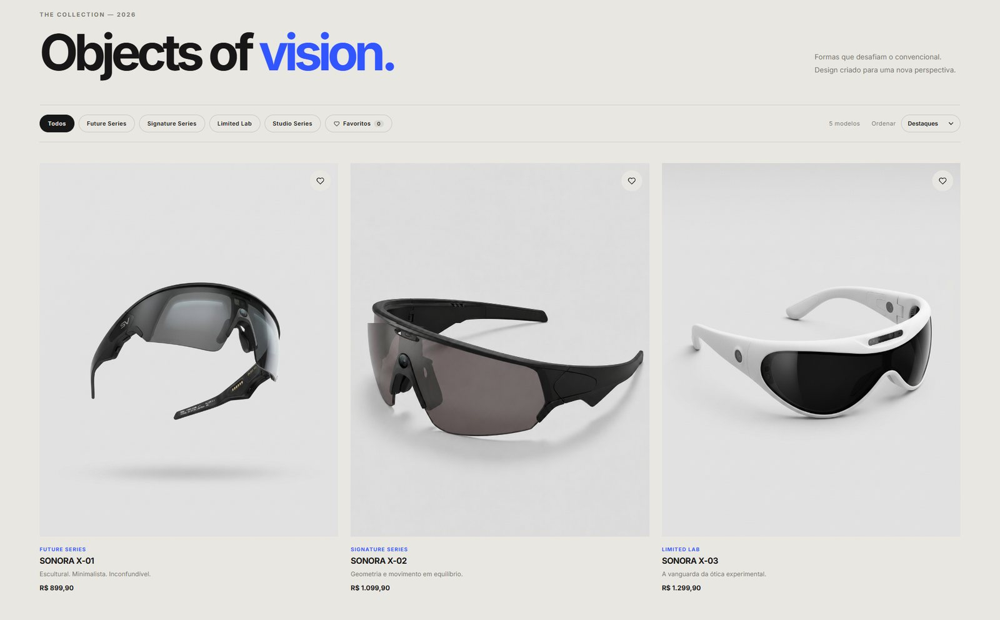

# SONORA® — Beyond Vision

E-commerce **full-stack** de óculos conceituais: front-end em **HTML, CSS e JavaScript puros** e back-end em **Node.js + Express + PostgreSQL**, com contas, pagamento com cartão (Stripe em modo de teste), painel administrativo e site em português e inglês.

> Projeto de estudo: a marca e os produtos são fictícios e nenhuma cobrança real é feita.


---

## Destaques

- **Loja completa:** catálogo vindo do banco, página de produto com galeria, sacola, favoritos, checkout e histórico de pedidos
- **Pagamento com cartão pelo Stripe Checkout** (modo de teste): o pedido só é confirmado depois que o servidor confere o pagamento. Pix e boleto são simulados
- **Painel administrativo:** visão geral de vendas, pedidos com mudança de status e cadastro de produtos com fotos, estoque e tradução automática
- **Estoque de verdade:** reservado no pedido, devolvido se o pagamento expirar ou o pedido for cancelado; dois clientes não compram a última peça ao mesmo tempo
- **Português e inglês** em tudo: textos, produtos, preços, datas, e-mails e mensagens de erro do servidor
- **Segurança:** bcrypt, sessão em cookie `httpOnly`, validação com Zod, CSP, limite de tentativas e SQL parametrizado
- **LGPD:** política de privacidade e exclusão de conta
- Fundo animado em **WebGL** (shader GLSL) e nenhum framework no front-end



---

## Funcionalidades

**Loja**
- Catálogo com filtro por série, ordenação por preço e selos de estoque ("Últimas unidades", "Esgotado")
- Página de produto (`produto.html?id=N`) com carrossel arrastável
- Sacola lateral sincronizada entre abas e com a conta (volta ao entrar, em qualquer aparelho)
- Checkout com ou sem login, busca de endereço pelo CEP ([ViaCEP](https://viacep.com.br)) e pagamento por Pix, boleto ou cartão (Stripe)
- E-mails de pedido confirmado e de mudança de status, no idioma da compra
- Conferência automática dos pagamentos: a cada 5 minutos o servidor pergunta ao Stripe pelos pedidos no cartão que ficaram parados (o cliente fechou a aba ou desistiu) e confirma ou expira cada um

**Conta**
- Cadastro, login, perfil, troca de senha e recuperação de senha por e-mail (link de uso único, válido por 1 hora)
- Histórico de pedidos
- Excluir conta: apaga conta, sacola e favoritos e desconecta todos os aparelhos

**Painel administrativo** (`admin.html`, só para contas admin)
- **Visão geral:** faturamento, ticket médio, pedidos a enviar e mais vendidos
- **Pedidos:** busca, filtro e mudança de status (enviado → entregue, ou cancelado), com aviso ao cliente por e-mail
- **Produtos:** lista paginada com busca, criação e edição completa (dados, estoque, textos PT/EN, especificações e fotos). Os textos são escritos em português e o inglês sai do botão "Traduzir do português"

---

## Tecnologias

| Camada | Tecnologias |
|---|---|
| Front-end | HTML, CSS, JavaScript (sem frameworks), WebGL |
| Back-end | Node.js 20+, Express 5, Zod, Nodemailer |
| Banco de dados | PostgreSQL (pgAdmin 4) |
| Pagamento | Stripe Checkout (modo de teste) |
| Segurança | bcrypt, express-session + connect-pg-simple, Helmet (CSP), express-rate-limit |

---

## Como rodar

**Pré-requisitos:** [Node.js](https://nodejs.org) 20+ e PostgreSQL (com pgAdmin 4).

1. **Banco:** no pgAdmin, crie um banco chamado `sonora`, abra o **Query Tool**, carregue `database/schema.sql` e execute (F5)
2. **Configuração:** copie `.env.example` para `.env` e preencha `PGPASSWORD` (a senha do PostgreSQL) e `SESSION_SECRET` (um texto longo e aleatório):
   ```bash
   node -e "console.log(require('crypto').randomBytes(48).toString('hex'))"
   ```
3. **Iniciar:**
   ```bash
   npm install
   npm run dev
   ```
   Abra **http://localhost:3000**
4. **Admin:** crie uma conta pelo site e rode `npm run admin -- seu@email.com`. Depois entre de novo e abra **Minha conta → Painel admin**

O `.env` guarda senhas e chaves: ele está no `.gitignore` e nunca vai para o GitHub.

<details>
<summary><strong>Opcional: pagamento com cartão (Stripe)</strong></summary>

1. Crie uma conta em [stripe.com](https://stripe.com), deixe o **modo de teste** ligado e copie a **Secret key** (`sk_test_...`) em **Developers → API keys**
2. Coloque no `.env`: `STRIPE_SECRET_KEY=sk_test_...` e reinicie o servidor
3. No checkout, use o cartão **4242 4242 4242 4242**, qualquer data futura e qualquer CVC ([outros cartões de teste](https://docs.stripe.com/testing))

O servidor recusa chaves reais (`sk_live_`). Sem a chave, Pix e boleto continuam funcionando.

**Webhook (opcional):** avisa na hora quando um pagamento é concluído. Sem ele, o servidor confere sozinho a cada 5 minutos. Localmente: `stripe listen --forward-to localhost:3000/api/payments/webhook` ([Stripe CLI](https://docs.stripe.com/stripe-cli)) e coloque o segredo `whsec_...` em `STRIPE_WEBHOOK_SECRET`.
</details>

<details>
<summary><strong>Opcional: envio de e-mails</strong></summary>

Sem configurar nada, cada e-mail é salvo como arquivo `.html` na pasta `outbox/` (o terminal mostra o caminho). Para enviar de verdade, preencha `SMTP_HOST`, `SMTP_PORT`, `SMTP_USER` e `SMTP_PASS` no `.env`:

- **[Mailtrap](https://mailtrap.io):** caixa de teste, nada chega a pessoas reais
- **Gmail:** `smtp.gmail.com`, porta `465`, `SMTP_SECURE=true` e uma **senha de app** (Conta Google → Segurança → Senhas de app)
</details>

<details>
<summary><strong>Opcional: tradução automática no painel</strong></summary>

Sem configurar nada, o painel usa o tradutor embutido do **Chrome/Edge** no computador (grátis, sem chave). Para usar o **DeepL** em qualquer navegador, crie uma chave grátis no plano [DeepL API Free](https://www.deepl.com/pro-api) e coloque em `DEEPL_API_KEY` no `.env`.
</details>

---

## Arquitetura

```
public/      Front-end: páginas HTML, CSS e JS (servidos pelo Express)
server/
  routes/        HTTP: valida a entrada e chama os repositórios
  repositories/  Todo o SQL, uma pasta por tabela
  lib/           Sessão, Stripe, e-mail, fotos, tradução, idiomas
  middleware/    Login, admin, validação e erros
database/    schema.sql: tabelas e catálogo inicial
scripts/     npm run admin
docs/        Imagens deste README
```

| Decisão | Por quê |
|---|---|
| **Preço calculado no servidor** | O navegador envia só o `id` e a quantidade; o preço vem do banco. O preço mostrado é sempre o preço cobrado |
| **Stripe Checkout** | O cartão é digitado na página do Stripe e nunca passa pelo servidor. A confirmação é feita no servidor, nunca confiando no navegador |
| **Sessão em cookie em vez de JWT** | O cookie `httpOnly` não é lido por JavaScript, e a sessão pode ser encerrada no servidor (ex.: ao trocar a senha) |
| **Estoque reservado no próprio `UPDATE`** | O desconto só acontece se houver unidades, dentro da transação do pedido, então não há venda acima do estoque |
| **Idiomas sem biblioteca** | Um dicionário PT/EN no front (`data-i18n`) e outro no servidor, que responde no idioma do `Accept-Language` |
| **Sem etapa de build** | Scripts com `defer` e um namespace `window.Sonora`: o servidor entrega os arquivos como estão |

<details>
<summary><strong>Banco de dados</strong></summary>

```
users ──< orders ──< order_items >── products ──< product_translations
users ──< cart_items >── products ──< product_images
users ──< favorites  >── products
users ──< password_resets
session
```

- **products:** código, nome, série, preço e estoque (`NULL` = sem controle, `0` = esgotado)
- **product_translations / product_images:** textos em PT e EN e a galeria (posição 1 = capa)
- **orders / order_items:** o item guarda nome e preço da época da compra. Pedidos no cartão começam como `awaiting_payment` e só viram `confirmed` depois do pagamento
- **users:** senha só como hash bcrypt; `role` = `customer` ou `admin`. Ao excluir a conta, os pedidos ficam registrados sem dono (`ON DELETE SET NULL`)
- **password_resets:** só o hash do código do link, a validade e o uso
</details>

<details>
<summary><strong>Segurança</strong></summary>

- Senhas com bcrypt e login com tempo constante (não revela quais e-mails têm conta)
- Cookie `httpOnly` + `sameSite=lax`, ID de sessão renovado no login e limite de tentativas no login, cadastro, pedidos e exclusão de conta
- Toda entrada validada com Zod, SQL sempre parametrizado e textos escapados antes de ir para o HTML
- Content Security Policy (Helmet) e redirecionamento pós-login só para páginas do próprio site
- Painel admin: o papel é conferido no banco a cada requisição, e a mudança de status só segue o caminho permitido
- Pagamento: valor da sessão vindo do banco, confirmação conferida com o Stripe e webhook só com assinatura válida. Só chaves de teste são aceitas
- Nova senha: código aleatório de 256 bits, guardado só como hash, válido 1 hora e uma vez; links montados só com `PUBLIC_URL` (contra *password reset poisoning*)
- Envio de fotos: tipo conferido pelo conteúdo do arquivo, nome gerado pelo servidor e galeria que só aceita fotos do próprio produto
</details>

<details>
<summary><strong>API</strong></summary>

| Rota | Acesso | O que faz |
|---|---|---|
| `GET /api/products` | — | Catálogo com textos PT/EN, fotos e estoque |
| `POST /api/auth/register` · `login` · `logout` · `GET me` | — | Conta e sessão |
| `POST /api/auth/forgot-password` · `reset-password` | — | Recuperação de senha |
| `PATCH /api/users/me` · `me/password` · `DELETE me` | login | Perfil, senha e exclusão da conta |
| `GET` / `PUT /api/cart` · `/api/favorites` (+ `/merge`) | login | Sacola e favoritos da conta |
| `POST /api/orders` · `GET /api/orders[/:number]` | — / login | Cria pedido (reserva estoque; `409` sem estoque) e histórico |
| `POST /api/payments/confirm` · `webhook` | — | Confirmação do pagamento pelo Stripe |
| `GET /api/admin/summary` · `orders` · `PATCH orders/:number` | admin | Visão geral e pedidos |
| `GET` / `POST /api/admin/products` · `PUT products/:id` · `POST products/:id/images` | admin | Produtos e fotos |
| `GET` / `POST /api/admin/translate` | admin | Tradução pelo DeepL |

Erros têm sempre o formato `{ "error": "mensagem", "fields": { "campo": "mensagem" } }`.
</details>

---

## Publicar (deploy)

O GitHub Pages só hospeda sites estáticos; este projeto precisa de um serviço que rode Node.js. Um caminho gratuito:

1. **Banco:** PostgreSQL no [Neon](https://neon.tech), rodando o `database/schema.sql`
2. **Servidor:** Web Service no [Render](https://render.com) (build `npm install`, start `npm start`)
3. **Variáveis:** `DATABASE_URL`, `DATABASE_SSL=true`, `SESSION_SECRET`, `NODE_ENV=production` e `PUBLIC_URL` (obrigatório, o endereço do site), mais as opcionais de Stripe, e-mail e DeepL do `.env.example`

As fotos enviadas pelo painel ficam no disco do servidor, que no Render gratuito é apagado a cada publicação. Para um site no ar de verdade, o envio deve ir para um serviço como [Cloudinary](https://cloudinary.com) ou S3; a troca fica concentrada em `server/lib/uploads.js`.

---

## Próximos passos

- [ ] Imagens otimizadas (WebP + `srcset`)
- [ ] Testes automatizados da API e do fluxo de compra
- [ ] Publicar o site

---

Desenvolvido por **Hentony Almeida** como projeto de estudo.
